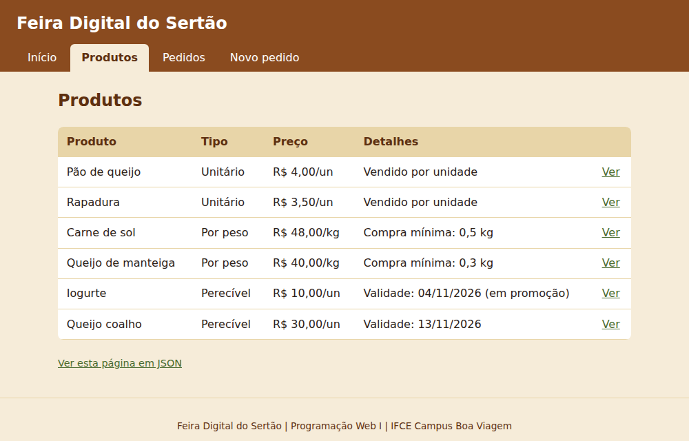
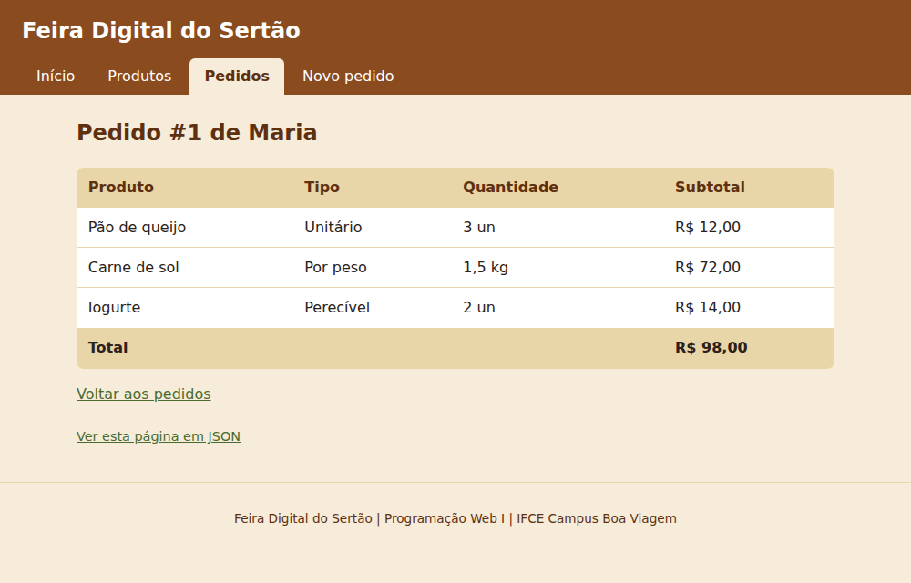
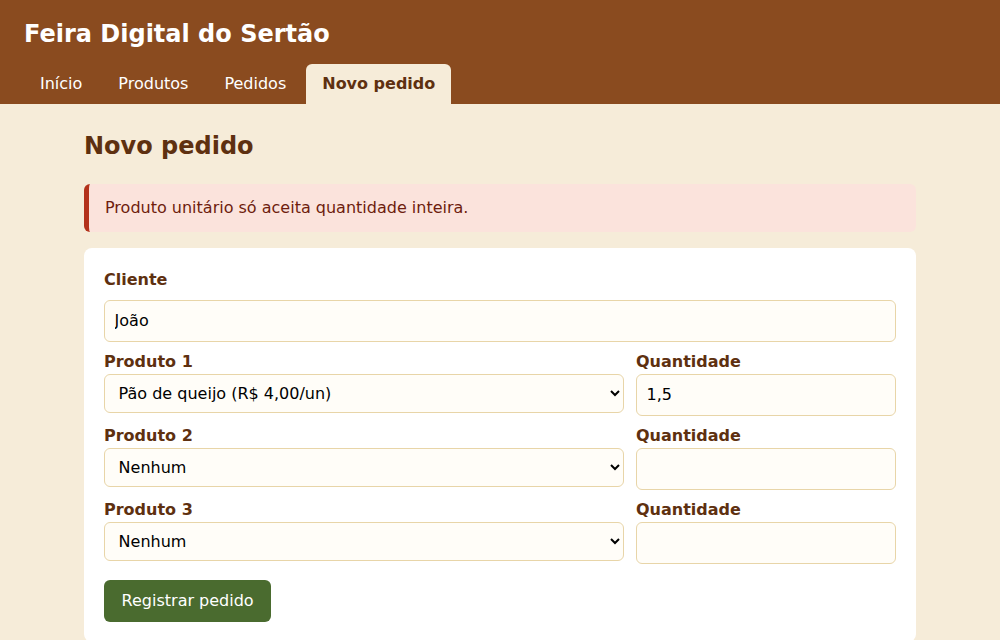

# Feira Digital do Sertão

> Trabalho individual de Programação Web I (IFCE Campus Boa Viagem): sistema web orientado a objetos em PHP.

**Autor(a):** Halef de Morais
**Tema:** 01, Feira Digital do Sertão
**Vídeo:** **(ACESSAR COM CONTA INSTITUICIONAL)** https://drive.google.com/file/d/1FTIBp7Cxkb2eZtFIdIXyJMOmAnrONuuy/view?usp=sharing

## O problema

Nas feiras do sertão, cada produto é vendido de um jeito: o pão de queijo por unidade, a carne de sol por peso com compra mínima, e o iogurte e o queijo fresco com prazo de validade curto. O sistema organiza o catálogo da feira e os pedidos dos clientes aplicando essas regras: quantidade inteira para itens unitários, peso mínimo para itens vendidos por quilo, recusa de produto vencido e desconto automático de 30% para o perecível que vence em até 2 dias. Serve a feirantes e organizadores que querem montar pedidos sem erro de quantidade, preço ou validade.

## Como executar

Requisitos: PHP 8.3 ou superior.

```
git clone https://github.com/221halef/pweb1-trabalho-oo.git
cd pweb1-trabalho-oo
php -S localhost:8000 -t public -d display_errors=1 -d output_buffering=0
```

Abra http://localhost:8000 (sem `/public` no endereço, porque a pasta `public` já é a raiz do site).

Para rodar o roteiro de testes no terminal:

```
php teste.php
```

## Telas

Página de produtos:



Detalhe de um pedido:



Formulário recusando um dado inválido:



## Rotas

| URL | O que mostra | Método | Status |
|---|---|---|---|
| `/` | Página inicial | GET | 200 |
| `/?pagina=produtos` | Catálogo de produtos | GET | 200 |
| `/?pagina=produto&id=3` | Detalhe de um produto | GET | 200 (404 se o id não existe) |
| `/?pagina=pedidos` | Lista de pedidos | GET | 200 |
| `/?pagina=pedido&id=1` | Itens e total de um pedido | GET | 200 (404 se o id não existe) |
| `/?pagina=inexistente` | Mensagem "Página não encontrada." | GET | 404 |
| `/?formato=json` | Produtos e pedidos em JSON; também funciona junto de `pagina` e `id` | GET | 200 (404 em JSON se o item não existe) |
| `/?pagina=novo-pedido` | Formulário de novo pedido | GET | 200 |
| `/?pagina=novo-pedido` (formulário) | Cria o pedido ou mostra a mensagem da regra recusada | POST | 200 |

## Regras de negócio

| Nº | Regra | Classe e método | Mensagem da exceção |
|---|---|---|---|
| 1 | Produto precisa de nome | `Produto::__construct` | O nome do produto não pode ficar vazio. |
| 2 | Produto precisa de preço maior que zero | `Produto::__construct` | O preço do produto deve ser maior que zero. |
| 3 | Quantidade precisa ser maior que zero | `Produto::validarQuantidade` | A quantidade deve ser maior que zero. |
| 4 | Produto unitário só aceita quantidade inteira | `ProdutoUnitario::validarQuantidade` | Produto unitário só aceita quantidade inteira. |
| 5 | Produto por peso exige a compra mínima | `ProdutoPorPeso::validarQuantidade` | A compra mínima de Carne de sol é 0,5 kg. |
| 6 | Peso mínimo precisa ser maior que zero | `ProdutoPorPeso::__construct` | O peso mínimo deve ser maior que zero. |
| 7 | Validade precisa ser uma data válida (AAAA-MM-DD) | `ProdutoPerecivel::__construct` | A validade deve ser uma data válida no formato AAAA-MM-DD. |
| 8 | Produto perecível não pode estar vencido | `ProdutoPerecivel::__construct` | O produto perecível não pode estar vencido. |
| 9 | Pedido precisa de cliente | `Pedido::__construct` | O nome do cliente não pode ficar vazio. |
| 10 | Produto não pode se repetir no pedido | `Pedido::adicionarItem` | O produto Pão de queijo já está no pedido. |

Além das regras das classes, o formulário recusa pedido sem nenhum produto, produto fora da lista e quantidade que não seja número.

## Documentação

- [Modelagem (diagrama de classes)](docs/modelagem.md)
- [Testes](docs/testes.md)
- [Diário de uso de LLM](docs/llm.md)
- [Relatório (PDF)](docs/relatorio.pdf)

## Ferramentas utilizadas

| Ferramenta | Para que usei |
|---|---|
| PHP 8.3 | Linguagem do sistema e servidor embutido (`php -S`) para rodar o site |
| Neovim | Editor para escrever o código e a documentação |
| Git e GitHub | Versionamento, issues, branches, pull requests e tags dos marcos |
| curl | Testar as rotas no terminal (`curl -i`) e conferir status e cabeçalhos |
| Navegador e DevTools | Ver as páginas e investigar erros no console |
| LLM: Claude | Explicar conceitos e erros, revisar o código e ajudar nos testes e na documentação |
| Gravador de tela: OBS-Studio | Gravar o vídeo de apresentação |
