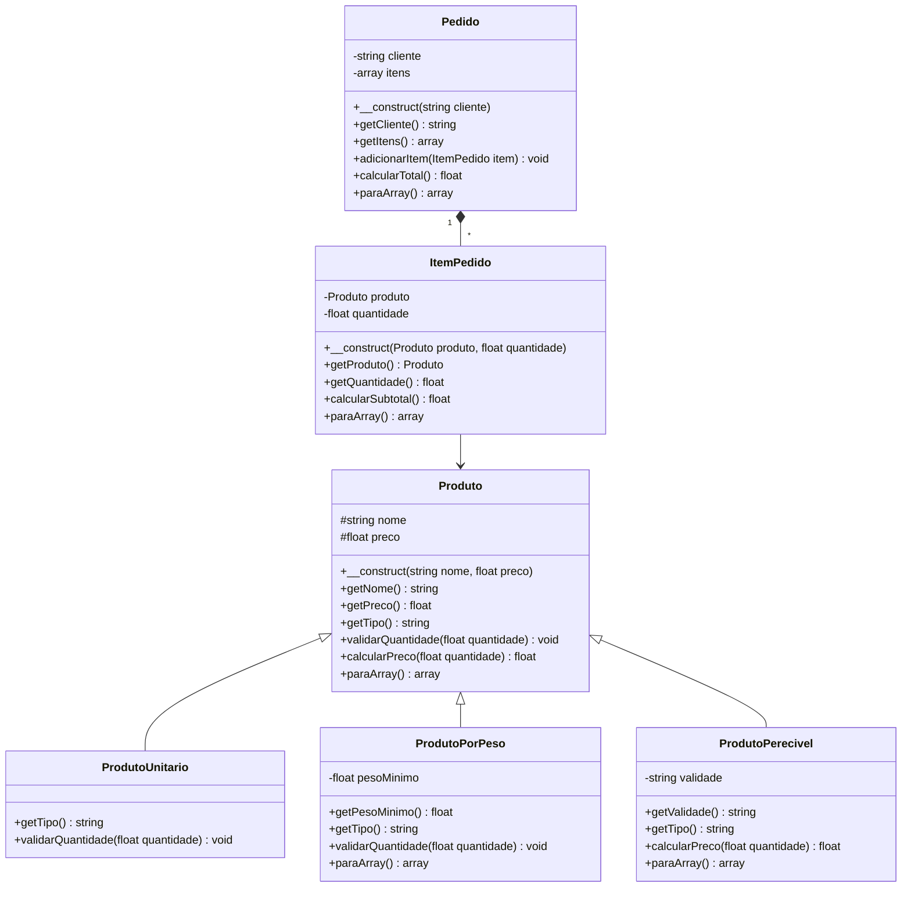

# Modelagem

## Diagrama de classes

Legenda: `<|--` herança ("é um"), `*--` composição ("tem um"), `#` protected, `-` private, `+` public.

## Justificativas

### Herança

A classe mãe é `Produto`. As filhas são `ProdutoUnitario`, `ProdutoPorPeso` e `ProdutoPerecivel`. A frase "X é um Y" vale para as três: um produto por peso é um produto, um produto perecível é um produto, e assim por diante. Todas herdam nome e preço, e cada uma chama `parent::__construct` para reaproveitar a validação do nome e do preço.

Cada filha sobrescreve métodos porque a feira vende de jeitos diferentes:
- `getTipo()` é sobrescrito nas três, para cada produto dizer o que é.
- `validarQuantidade()` é sobrescrito em `ProdutoUnitario` (só aceita quantidade inteira) e em `ProdutoPorPeso` (exige o peso mínimo). As duas chamam `parent::validarQuantidade()` antes, para manter a regra de quantidade maior que zero.
- `calcularPreco()` é sobrescrito em `ProdutoPerecivel`, que dá 30% de desconto quando faltam 2 dias ou menos para o vencimento.
- `paraArray()` é sobrescrito em `ProdutoPorPeso` e em `ProdutoPerecivel`, para incluir os dados extras no JSON.

### Composição

`Pedido` guarda uma lista de `ItemPedido`, e cada `ItemPedido` guarda um `Produto` e uma quantidade. A relação é "tem um": um pedido tem itens, e não é um item. Um item não faz sentido sem o pedido a que pertence. Por isso o `Pedido` tem `adicionarItem` para montar a lista e `calcularTotal` para somar os subtotais. O `ItemPedido` só se liga ao `Produto` (seta simples), porque o produto existe sozinho no catálogo.

### Encapsulamento

Nenhum atributo é `public`. Em `Produto`, `nome` e `preco` são `protected`, para que as filhas os usem sem que o código de fora os altere. Os outros atributos são `private`. Todos têm getter. Não criei setters: os dados são validados uma única vez no construtor e depois não mudam, então não há como deixar um objeto em estado inválido.

## Regras de negócio

| Nº | Regra | Classe e método |
|---|---|---|
| 1 | Produto precisa de nome e preço maior que zero | `Produto::__construct` |
| 2 | Quantidade precisa ser maior que zero | `Produto::validarQuantidade` |
| 3 | Produto unitário só aceita quantidade inteira | `ProdutoUnitario::validarQuantidade` |
| 4 | Produto por peso exige o peso mínimo | `ProdutoPorPeso::validarQuantidade` |
| 5 | Produto perecível não pode estar vencido | `ProdutoPerecivel::__construct` |
| 6 | Pedido precisa de cliente e não aceita produto repetido | `Pedido::__construct` e `Pedido::adicionarItem` |
